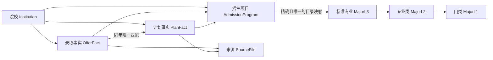

# VRS 志愿推荐系统

基于 **FastAPI、Neo4j 知识图谱与 DeepSeek** 的高考志愿规划示例系统。当前业务范围是**浙江生源、2019–2024 年历史录取参考**。用户输入位次、选科、专业领域和意向省市，生成冲稳保候选，并查看来源、历年趋势及 AI 辅助分析。

公开仓库包含代码、环境配置样例、**14 份 Excel 合成示例模板**，以及从本地已构建 Neo4j 导出的**完整浙江历史知识图谱快照**。克隆后可直接导入，无需先收集原始 Excel。快照包含公开招生事实及其来源，不包含考生成绩、SQLite、数据库账户、密码或 API Key；真实原始 Excel 不随仓库分发。

## 功能

| 模块 | 功能 |
| --- | --- |
| 规划工作台 | 分数与浙江位次、三门选科、专业领域、意向省市、目标院校、策略参数、草稿保存 |
| 志愿推荐 | 全量历史候选、可选位次窗口、选科子集匹配、冲稳保分层、搜索筛选、来源行号、待核实记录 |
| 院校对比 | 同校同招生专业的历年最低分、位次、计划、排名及满意度 |
| 专业介绍 | 三级目录、原始简介、学位信息、AI 解读、职业路径与市场探索 |
| 成绩轨迹 | 文本录入、图片 OCR、成绩整理、趋势图与优势分析 |
| 模拟沙箱 | 改变位次和偏好，比较两份候选方案 |
| 知识图谱 | 探索院校、招生项目、标准专业、专业类、门类及就业流向关系 |
| 本地策略 | SQLite 策略保存、回收站与恢复，浏览器 localStorage 草稿与对比状态 |
| 环境检查 | 所有业务页面显示 API Key 是否填写、Neo4j 与图谱就绪状态、OCR 程序及中英文语言包；可手动验证 API 认证与模型配置 |

## 技术栈

| 层次 | 使用技术 |
| --- | --- |
| 后端 | Python 3.12、FastAPI、Uvicorn、Pydantic |
| 页面 | Jinja2、原生 HTML/CSS/JavaScript，本地 ECharts 5.5.0 |
| 图数据库 | Neo4j Community，Cypher，HTTP 事务接口 |
| 本地存储 | SQLite；浏览器 localStorage |
| 数据导入 | openpyxl 流式读取 Excel，事实来源与 SHA-256 追踪 |
| AI | DeepSeek 云端 API，当前已验证模型 ID 为 `deepseek-flash` |
| OCR | Tesseract 5、pytesseract、Pillow，中文/英文语言包 |
| 桌面入口（可选） | PyQt6、PyQt6-WebEngine |
| 测试 | unittest、FastAPI TestClient/httpx、Node.js 前端逻辑检查 |

无需 npm 安装或前端构建，页面资源由 FastAPI 直接提供。

## 环境与外围软件

已在 Windows、Python 3.12.14、Neo4j Community 2026.04.0 和 Java 25 上验证。其他 Neo4j 版本请先确认其 Java 要求及 HTTP 事务接口兼容性。默认使用云端模型，不要求本地 GPU 或 Ollama。

| 软件 | 是否必需 | 安装或使用链接 |
| --- | --- | --- |
| Python 3.12（64位） | 必需 | [Python 下载](https://www.python.org/downloads/windows/) |
| Git | 克隆和提交时需要 | [Git 下载](https://git-scm.com/downloads) |
| Neo4j Community | 图谱与推荐必需 | [下载](https://neo4j.com/deployment-center/) · [Windows 安装](https://neo4j.com/docs/operations-manual/current/installation/windows/) |
| Java/JDK | 运行独立 Neo4j 必需 | [Neo4j 系统要求](https://neo4j.com/docs/operations-manual/current/installation/requirements/) · [Temurin JDK 下载](https://adoptium.net/temurin/releases/) |
| DeepSeek API | 六项 AI 功能需要 | [平台与密钥](https://platform.deepseek.com/) · [API 文档](https://api-docs.deepseek.com/) |
| Tesseract OCR | 图片识别时需要 | [官方安装说明](https://tesseract-ocr.github.io/tessdoc/Installation.html) · [Windows 安装包](https://github.com/UB-Mannheim/tesseract/wiki) |
| OCR 语言包 | 中文图片识别时需要 | [chi_sim](https://github.com/tesseract-ocr/tessdata_fast/blob/main/chi_sim.traineddata) · [eng](https://github.com/tesseract-ocr/tessdata_fast/blob/main/eng.traineddata) |
| Node.js | 仅前端自动测试需要 | [Node.js 下载](https://nodejs.org/en/download) |
| Ollama | 可选兼容代码，主流程不用 | [Ollama 下载](https://ollama.com/download) |

### Neo4j 设置

1. 安装与 Neo4j 版本匹配的 JDK，配置 `JAVA_HOME`，解压 Neo4j Community。
2. 启动 Neo4j，例如在 Neo4j 安装目录执行 `bin/neo4j console`。Windows 使用 `bin/neo4j.bat console`。
3. 打开 [本机 Neo4j Browser](http://localhost:7474)，按官方流程完成首次登录并设置自己的数据库密码。
4. 在项目 `.env` 中填写 HTTP 地址、数据库名、用户名和密码。默认 HTTP 7474，Bolt 7687；**本项目配置 `NEO4J_URL` 使用 HTTP 地址，不使用 bolt://**。
5. 使用独立的 VRS 数据库/实例。Community 版通常只支持一个标准用户数据库；需要隔离示例与真实资料时，应使用不同实例/数据目录。普通开发不需要 APOC 或 GDS 插件。

### OCR 设置

安装 Tesseract 后，把 `chi_sim.traineddata` 和 `eng.traineddata` 放入其 `tessdata` 目录。将可执行文件加入 PATH，或设置 `TESSERACT_CMD` 为本机 `tesseract.exe` 的完整路径。

```powershell
tesseract --version
tesseract --list-langs
```

语言列表应包含 `chi_sim` 和 `eng`。若未安装 OCR，文字录入、图谱、推荐与对比仍可使用，图片识别不可用。

## 安装与配置

以下以 Windows PowerShell 为例，命令在项目根目录执行：

```powershell
git clone https://github.com/JieChiang/VRS-Zhiyuan-Recommendation.git
cd VRS-Zhiyuan-Recommendation
py -3.12 -m venv .venv
.\.venv\Scripts\python.exe -m pip install --upgrade pip
.\.venv\Scripts\python.exe -m pip install -r requirements.txt
Copy-Item .env.example .env
```

只在 `.env` 不存在时复制，避免覆盖已配置的凭据。编辑 `.env`，至少填写 `NEO4J_PASSWORD`；需要 AI 功能时再填写 `DEEPSEEK_API_KEY`。示例配置中的密码和密钥均留空。

| 环境变量 | 默认/示例 | 说明 |
| --- | --- | --- |
| `NEO4J_URL` | `http://localhost:7474` | Neo4j HTTP 地址 |
| `NEO4J_DB` | `neo4j` | 项目数据库 |
| `NEO4J_USER` | `neo4j` | 用户名 |
| `NEO4J_PASSWORD` | 留空 | 必须填写自己设置的密码，无内置密码 |
| `DEEPSEEK_API_KEY` | 留空 | AI 功能密钥，仅服务端读取 |
| `DEEPSEEK_BASE_URL` | `https://api.deepseek.com` | API 基础地址 |
| `DEEPSEEK_MODEL` | `deepseek-flash` | 已验证模型 ID，后续换型需核实官方接口 |
| `DEEPSEEK_TIMEOUT` | `90` | 超时秒数 |
| `TESSERACT_CMD` | `tesseract` | PATH 名称或完整路径 |
| `APP_HOST` | `127.0.0.1` | 默认只监听本机 |
| `APP_PORT` | `8000` | 服务端口 |
| `VRS_ENV_FILE` | 不设置 | 可指定仓库外的私有环境文件 |

配置优先级：**已有进程环境变量 → `VRS_ENV_FILE` 指向的文件 → 项目 `.env` → 用户私有配置 → `setting.yaml` → 默认值**。用户私有配置为 Windows `%APPDATA%/VRS/private.env`，其他系统为 `~/.config/VRS/private.env`。修改配置后重启服务。

`.env`、私有配置、SQLite、真实原始 Excel、原生 dump、日志及本机交接报告不进入 Git。**专门审查过的 `graph_snapshot/` 逻辑快照随仓库分发**。`setting.yaml` 只保留无密钥的通用示例。不要把密钥写在 Python、JavaScript 或 README 中。

### 首次启动必须检查的配置

登录后，系统会实际检查数据库连接、对应图谱是否就绪、Tesseract 能否运行及 `chi_sim` / `eng` 是否安装。**仅检测到配置缺失或不可用时，页面顶部才显示相关问题；配置正常时不显示提示。**侧栏保留“环境与 API 配置”入口，供手动查看详情和验证 API。已填写但尚未验证的 Key 不作为故障提示；模型验证失败或配置不匹配时会提示。检查结果缓存 30 秒；修改 `.env` 后需重启服务。

| 页面状态 | 处理方式 / 影响 |
| --- | --- |
| 数据库密码未填写 / 连接失败 | 填写 `NEO4J_PASSWORD`，启动 Neo4j，核对 HTTP 地址、数据库名、用户名及密码；图谱相关功能需要它 |
| 数据库已连接，图谱未导入 / 尚未就绪 | 按下一节导入快照，或从 Excel 构建；完成后重新检查 |
| API Key 未填写 | 在本机 `.env` 填写 `DEEPSEEK_API_KEY` 并重启；AI 问答与分析需要 Key，规则推荐与图谱查询不需要 |
| API Key 已填写，尚未验证 | 点击“验证 API 连接”；填写不代表认证成功 |
| API 认证成功，模型可见 | Key 与配置的模型已通过模型列表验证；实际生成仍受额度、服务状态影响 |
| API 认证失败 / 模型配置不匹配 | 检查平台 Key、`DEEPSEEK_BASE_URL`、`DEEPSEEK_MODEL`；界面不会显示 Key 内容 |
| OCR 未安装 / 语言包不完整 | 安装 Tesseract 与中英文语言包；只影响成绩图片识别，不影响文字录入或推荐 |

API 验证使用官方 [`GET /models`](https://api-docs.deepseek.com/zh-cn/api/list-models/)，只在点击按钮时请求，不发送成绩或调用文本生成。认证结果缓存最多 5 分钟，按钮连续操作限于每 30 秒一次。Java 是运行 Neo4j 的外围依赖，连接失败时请对照其安装要求检查；当前云端主流程无需安装 Ollama。

## 直接导入仓库中的完整知识图谱（推荐）

`graph_snapshot/` 来自本地已构建的浙江 2019–2024 年图谱，包含 **317,582 个节点、1,499,418 条关系**，其中录取事实 116,451 条、计划事实 78,246 条；标签/关系类型数量、生成时间和 SHA-256 见 [manifest.json](graph_snapshot/manifest.json)。原始来源文件、工作表、行号和来源哈希随事实保留，缺失与冲突标记也会保留。

这是 **gzip 压缩 JSON Lines 逻辑快照**，包含节点、关系、属性和项目索引/约束。它使用项目脚本通过 Neo4j HTTP 接口恢复，无需停库、APOC、Bolt 驱动或原始 Excel；**不能直接交给 `neo4j-admin database load`**。已在 Neo4j Community 2026.04.0 验证；脚本使用 Cypher 5，其他版本应先在空实例测试。

1. 安装并启动 Neo4j，完成首次登录、设置自己的密码。
2. 使用**专用于本项目的全新空数据库/实例**。Community 版可使用一个独立安装的数据目录，不要指向存有其他图谱的实例。
3. 安装项目 Python 依赖，复制 `.env.example`，填写 Neo4j 配置。导入不需要 DeepSeek API Key，也不需要 OCR。
4. 在项目根目录执行：

```powershell
# 只检查快照文件与内容，不连接数据库
.\.venv\Scripts\python.exe scripts/graph_snapshot.py validate
# 校验通过后，导入 .env 指定的空数据库
.\.venv\Scripts\python.exe scripts/graph_snapshot.py import
# 如机器内存较小，可调小单批写入量（默认2000）
# .\.venv\Scripts\python.exe scripts/graph_snapshot.py import --batch-size 500
```

导入前校验两份压缩文件的 SHA-256、内容哈希和记录数量；随后分批创建节点及关系，恢复项目索引/约束，再核对总数、各标签与关系类型数量。**非空数据库直接拒绝，脚本没有自动删库选项**；不会导入 `system` 数据库、认证信息或原数据库的内部 ID。内部 ID 仅用于快照内连接，导入后会重新分配。

导入约需数分钟，具体取决于磁盘、内存与 Neo4j 配置。如果中断或失败，目标库可能已有部分数据；请使用新的空库/独立实例重试，不要直接再次导入。导入期间 Dataset 标记为未就绪，成功后才恢复可用。详细格式与操作见 [快照说明](graph_snapshot/README.md)。

完成后启动 Web 服务，在“环境与 API 配置”中确认“数据库已连接，图谱已就绪”，再生成推荐。**直接导入快照与下面从 Excel 重建二选一**，不需要重复执行。

## 从自己的 Excel 重新构建知识图谱

### 准备资料

当前完整数据契约为 14 份 Excel，模板位于 [data_templates](data_templates/README.md)，各列、类型和规则见 [数据模板说明](docs/数据模板说明.md)。

| 数据类别 | 文件/数量 | 内容 |
| --- | --- | --- |
| 标准专业目录 | 大学专业基础信息.xlsx | 门类、专业类、专业、代码、学位及简介 |
| 历年录取 | 专业分数线.xlsx | 院校、招生专业、2019–2024最低分与位次 |
| 招生计划 | 招生计划.xlsx | 选科、年度计划、招生代码、学费、学制和备注 |
| 满意度 | 院校满意度.xlsx、专业满意度.xlsx | 分值及投票人数 |
| 就业 | 院校就业流向.xlsx | 学校省市、就业地区、单位性质 |
| 学科评估 | 第四轮全国高校学科评估结果.xlsx | 学科、等级及院校 |
| 排名与院校属性 | 2021四类排名、2021–2023软科，共7份 | 榜单、年份、排名、地区与院校属性 |

当前完整导入最少需要前7份基础表（满意度为2份）和至少1份带年份的排名表，即至少8份；推荐使用全部14份模板。缺少基础文件时导入器会拒绝执行。合成行仅用于学习字段和演示，真实导入前应替换，不能混入真实录取数据。

### 先使用合成示例

```powershell
.\.venv\Scripts\python.exe scripts/prepare_demo_data.py
.\.venv\Scripts\python.exe scripts/rebuild_graph.py --validate --data-dir data/demo
.\.venv\Scripts\python.exe scripts/rebuild_graph.py --sample 2 --data-dir data/demo
# 确认.env指向独立、空的项目库后执行：
.\.venv\Scripts\python.exe scripts/rebuild_graph.py --data-dir data/demo
```

示例复制到不存在或空的 `data/demo/`，不会覆盖现有资料。`--validate` 只校验必需文件与表头，不连接数据库。构建会写入所配置的数据库。若目标库已有数据，默认拒绝覆盖；只有明确需要删除后重建并已备份时才使用 `--replace`，它会删除目标库图谱及旧索引、约束。

真实资料放入自己的独立目录，再替换 `--data-dir` 路径；默认为项目 `data/`。构建过程流式读取、分批写入，不改原始 Excel。报告生成到本地 `docs/graph_build_report.json`，该报告不随公开仓库提交。

### 图谱结构



分数、位次和计划数作为事实属性保存，不为每个数字建节点。事实保留文件、工作表、行号和来源关系。招生专业组和标准专业分开保存；缺失年份不复制，冲突值不取平均，无法唯一匹配的计划不任选。完整设计见 [知识图谱说明](docs/知识图谱重构方案.md)。

## 启动使用

```powershell
.\.venv\Scripts\python.exe run_server.py
```

打开 [应用首页](http://127.0.0.1:8000) 或 [接口文档](http://127.0.0.1:8000/docs)。演示登录接受非空用户名与密码，请使用临时演示内容。当前登录和部分 API 不具备正式多用户鉴权，公开的是代码仓库，不代表应用已经适合直接部署到公网。

如需保持开发预览端口8765：

```powershell
.\.venv\Scripts\python.exe -m uvicorn app.main:app --host 127.0.0.1 --port 8765
```

### Windows 双击启动（已有 Conda 环境）

双击根目录的 `启动项目.bat`。脚本默认激活 `D:\Software\Miniconda3\envs\VRS`，使用该环境的 Python 检查依赖，缺少依赖时按 `requirements.txt` 安装，再启动项目并在页面就绪后自动打开 `http://127.0.0.1:8765`。这套启动方式另在 Python 3.11.15 的 Conda 环境验证通过。

其他机器需要把 BAT 中的 `VRS_CONDA_ENV` 和 Miniconda `activate.bat` 路径改为自己的安装位置。请先启动 Neo4j，配置自己的数据库密码与 API Key；BAT 不包含凭据、不修改私有配置，也不会自动启动 Neo4j。重复双击会复用已运行的 VRS 服务；端口被其他程序占用时会提示错误。关闭首次启动的控制台窗口或按 Ctrl+C 可停止 Web 服务。

```powershell
# 可选：仅启动服务，不自动打开浏览器
.\启动项目.bat --no-browser
```

可选桌面入口：先安装 `requirements-desktop.txt`，再运行 `desktop_app.py`。该入口保留，但尚未做 PyQt 窗口验收。`/api/v1/health` 为兼容健康接口，模型 `configured` 仅代表配置存在；登录后的 `/api/v1/setup/status` 提供独立的环境检查，`POST /api/v1/setup/verify-model` 手动验证模型访问。

## 推荐规则与数据范围

- 默认 `candidate_scope=all` 检索符合条件的全部历史位次，再排序分层。只有显式 `window` 才使用位次窗口，避免把较安全的候选截掉。
- 选科按“学校要求是考生选科的子集”核验；不限或有匹配计划的空白要求对任意组合开放；没有匹配计划则待核实。
- 完整填写三门时，主推荐仅包含已满足明确选科要求的历史项目，未知要求单列；只填一两门时保留未知探索候选。
- 专业类优先于同名门类，支持“法学专业”“法学门类”、财会与师范等解释，页面显示实际范围。
- 默认80条、最多300条；比例为0的冲/稳/保层不参与推荐或补足。沿用±300位次分界，概率与策略权重尚未用真实录取样本校准。
- 分数不作第二次硬过滤。当前缺少一分一段表、批次和完整招生限制，选科符合不等于完成所有报考资格认证。
- 原计划表选科是行级要求，没有逐年分别列示。增加年份、生源省份或政策结构时，需要同步代码、数据范围和测试。

六项 AI 功能统一调用云端：问答、专业介绍、成绩整理、优势分析、职业模拟、市场探索。服务端重新检索图谱证据，模型输出不作为录取事实；问答不会把少量上下文节选说成全部候选。市场评分为模型意见，没有实时就业统计保证。调用会发送问题、相关成绩文本和少量证据到 DeepSeek，并消耗对应 API 额度。

## 测试

```powershell
.\.venv\Scripts\python.exe -m pip install -r requirements-dev.txt
.\.venv\Scripts\python.exe -m unittest discover -s tests -v
node tests/frontend_regression.cjs
.\.venv\Scripts\python.exe scripts/check_secrets.py --history
.\.venv\Scripts\python.exe scripts/rebuild_graph.py --validate --data-dir data_templates
.\.venv\Scripts\python.exe scripts/graph_snapshot.py validate
```

单元测试使用模拟服务，不要求真实模型调用。`verify_graph.py`、`verify_workflows.py`、`verify_subjects.py`、`verify_rank120000.py`、`verify_combinations.py` 是针对原完整浙江资料的真实数据库核验，不能把其固定数量断言用于少量合成模板。最新完整数据基线曾覆盖35种三门选科与15组条件，549次接口检查通过。

`python scripts/verify_llm.py --live` 会真实调用付费 API；仅在明确需要验收模型且已准备相应图谱资料时使用。图片功能有合成中文样例验收，尚不等于完成各种真实成绩单验收。

## 目录

```text
app/                     页面、API、图谱查询与推荐服务
data/                    本地真实资料，不随Git发布
data_templates/          14份合成Excel模板、字段契约和填写说明
graph_snapshot/          完整浙江图谱逻辑快照、校验清单和导入说明
docs/                    公开设计和数据说明；本机报告默认忽略
scripts/                 重建、只读校验、示例准备和检查工具
tests/                   单元与前端回归
storage/                 运行生成的本机SQLite，不随Git发布
.env.example             无密码、无密钥的配置样例
setting.yaml             通用默认配置
requirements.txt         Web运行依赖
requirements-dev.txt     测试依赖
requirements-desktop.txt 可选PyQt桌面依赖
run_server.py            Web开发启动入口
启动项目.bat             Windows Conda 环境双击启动入口
desktop_app.py           可选桌面入口
```

ECharts 保留第三方许可证，见 `app/static/vendor/`。公开仓库不分发原始招生资料或模型密钥；使用外部资料和第三方组件应遵循各自来源与许可。
