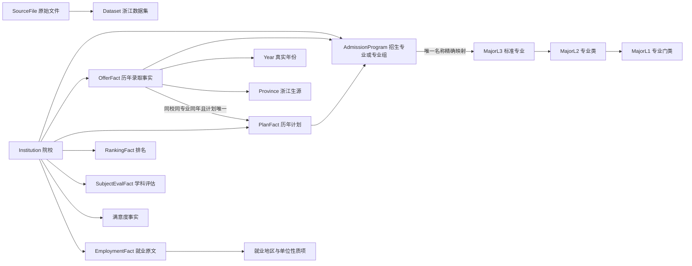

# 浙江样例知识图谱说明

## 适用性判断

适合使用知识图谱。院校、招生专业、标准专业、专业层级、学科评估及就业流向之间有明确的连接需求，能直接支持专业介绍、院校对比和关系探索。分数、位次、计划数和满意度作为事实节点的数值属性保留，建立索引后用于筛选和统计；不把每个数值都拆成节点。

原始 Excel 是唯一数据源，Neo4j 是可重建的查询层。本次不使用旧数据包，也不调用 AI 清洗或补造录取事实。

## 原始数据映射

| 原始资料 | 图谱内容 | 处理方式 |
| --- | --- | --- |
| 2021 年四类排名、2021–2023 软科资料 | Institution、RankingFact、InstitutionProfile | 保留榜单、真实年份、学校所在地与原始字段；2022 分榜与总榜分开 |
| 大学专业基础信息 | MajorL1、MajorL2、MajorL3 | 三级目录按类型和代码隔离同名层级；代码不规范时只参考同一行描述修复，并记录原代码 |
| 第四轮全国高校学科评估结果 | SubjectEvalFact | 跳过开头空行，保留学科、第四轮、评级与来源行 |
| 专业分数线 | AdmissionProgram、OfferFact | 宽表按真实年份展开，分数或位次均缺失则不建立该年份事实 |
| 招生计划 | PlanFact | 独立保留各年计划数、地方招生代码、选科、学费、学制和备注 |
| 院校满意度、专业满意度 | InstitutionSatisfaction、MajorSatisfaction | 缺失不是 0；保留来源，专业投票人数保留原值 |
| 院校就业流向 | EmploymentFact、EmploymentFlowItem、EmployerTypeItem | 原文完整保存，显式百分比结构化；不猜统计年份 |

## 结构

实际来源关系方向为事实 `FROM_SOURCE → SourceFile`，文件由数据集 `HAS_SOURCE` 关联。图示只表达主要对象。招生事实也有 `IN_DATASET` 关系。

## 关键规则

1. 生源固定为用户确认的浙江，院校所在地是另一个维度。推荐、历史概率及对比不会跨省混用位次。
2. 招生专业组独立保存，不把“法学类”“试验班”冒充标准目录专业。未能精确映射的名称保留原样，仍可推荐与比较。
3. 地方院校/专业招生代码保存在 PlanFact；专业目录代码保存在 MajorL3，不相互替代。
4. 原表没有的年度数据不复制、插值或推算。参考年份从实际图谱记录生成。
5. 同一学校、招生专业、年份的分数线若存在互相冲突的不同值，会保留事实并标记，推荐与趋势不混入这些冲突记录。多个计划条目无法唯一对应时，不把计划数相加或任选一条。
6. 选科按可匹配到的同年计划原文解析“和/或/不限”，明确要求须是考生选科的子集。原表不限或匹配计划的空白要求对任意组合开放；计划缺失或无法解析则待核实。用户未填全三门时，已满足明确要求及不限条目照常保留，其余未知作为探索候选；填全后未知另列，不计入已核验推荐。
7. 排名保留榜单和真实年份。查看某年详情时使用各榜单截至该年的最新已有记录，显示实际榜单年份。
8. 历史概率只使用截至参考年的数据；策略排序采用可复现的偏好权重与分层配额，分数不冒充录取概率。
9. 对比使用同校、同招生专业、同生源的精确匹配，不再用双向模糊专业匹配和跨记录均值代替实际分数线。
10. 每条事实可追溯文件、工作表、行号，SourceFile 记录 SHA-256。构建完成后写入构建报告，并将 Dataset 状态改为 ready。

## 约束与索引

院校、目录实体、招生项目、事实、数据集和来源文件均有稳定标识及唯一约束。录取检索建立 `(dataset_id, province, year, min_rank)` 组合索引，以范围比较代替对全部位次调用绝对值再筛选。计划和录取关联使用 `(program_id, year)` 索引。

## 重建与清理

入口为 `scripts/rebuild_graph.py`，支持只取样的 `--sample` 和明确替换的 `--replace`。完整导入按 500 条一批处理，不把大表内容输出给模型，不修改原始文件。

旧图谱已经过明确授权清理。其他 Neo4j 数据库不属于本次目标。旧数据整理中间文件及导出从项目移入系统回收站，具体路径与大小见 `cleanup_report.json`。

## 仍需确认

原表未标注的科类/批次、选科要求对应的政策年份、满意度和就业数据统计年份、排名中原表“综合得分”的口径、满意度中交叉命名的投票列，均不自动推断。详见待补充信息表。
